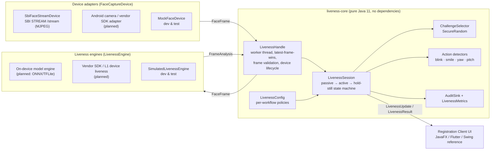
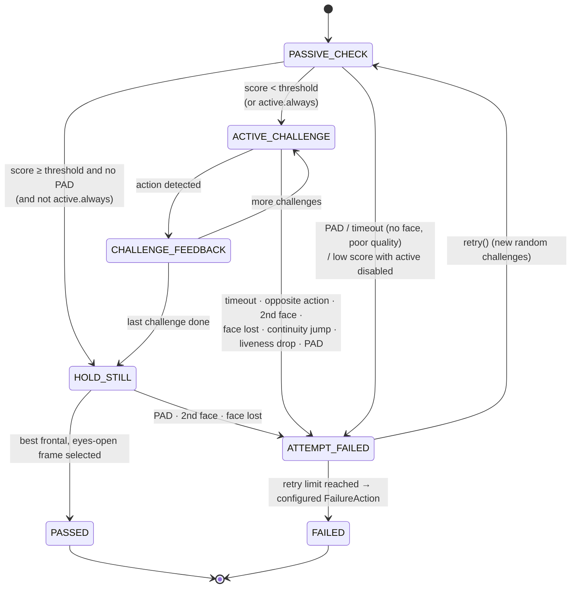
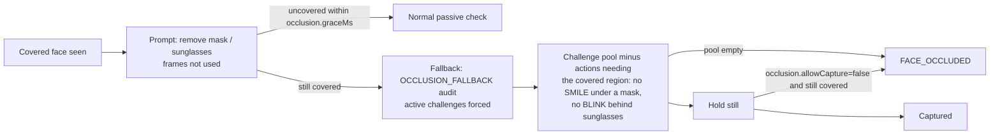
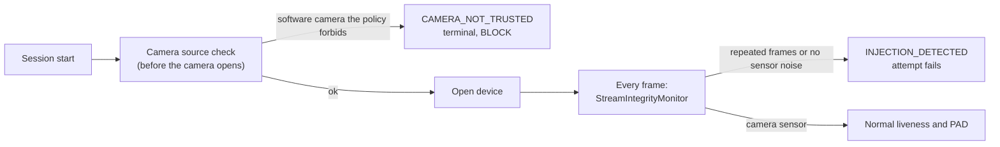
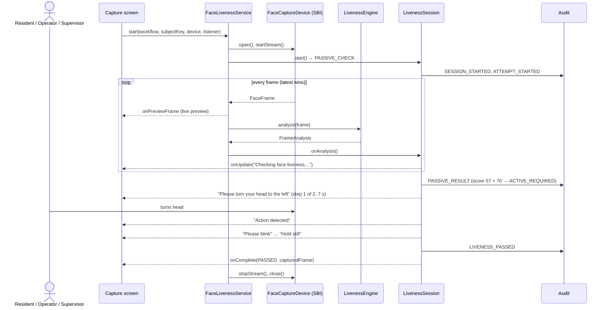
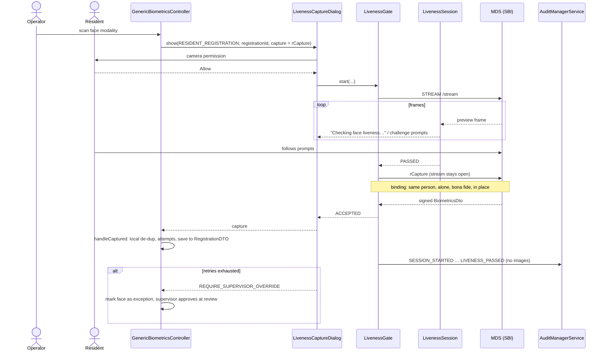
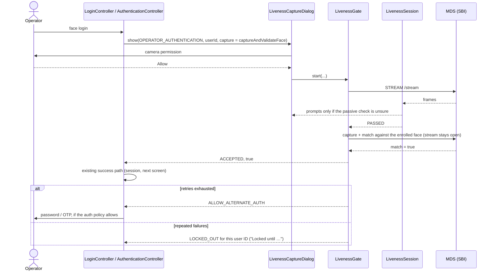

# Face Liveness and PAD for the MOSIP Registration Client: Technical Design

Problem statement 04, MOSIP Decode. This document covers the architecture implemented in this repository
and the integration plan for the Desktop and Android Registration Clients. Companion documents:

- [UI_UX.md](UI_UX.md): screens, states and messages for the three workflows, desktop and Android.
- [TECHNOLOGY_EVALUATION.md](TECHNOLOGY_EVALUATION.md): why these models and runtimes, with measurements.
- [REGCLIENT_INTEGRATION.md](REGCLIENT_INTEGRATION.md): the controller changes in `mosip/registration-client`.

## 1. Goals

- Verify that the face presented during **resident face capture**, **operator authentication** and
  **supervisor authentication** belongs to a live person, and reject presentation attacks.
- **Hybrid** verification: passive liveness first (no user action). Escalate automatically to **active,
  randomly selected challenges** only when the passive confidence is below a configurable threshold.
- Work identically **online and offline**; stay **vendor neutral** (any compliant L0/L1 device, any
  liveness technology).
- Keep the person's experience simple: plain prompts, no exposed model details, clear retry and recovery.

## 2. Architecture



### Responsibilities

| Layer | Interface | Owns | Never does |
|---|---|---|---|
| Device adapter | `FaceCaptureDevice`, `FrameListener` | Transport, formats, connect/disconnect | Liveness decisions |
| Engine | `LivenessEngine` → `FrameAnalysis` | Per-frame measurements: faces, quality, eye openness, smile, head pose, passive score, PAD verdict + attack type | Thresholds, retries, prompts |
| Session | `LivenessSession` | Every decision: thresholds, challenge choice, timeouts, retries, failure handling | Pixel processing, I/O |
| Service | `FaceLivenessService`, `LivenessHandle` | Threading, backpressure, device lifecycle, error mapping | Policy |

The split means a new vendor needs only a device adapter, and a new liveness technology needs only an engine.
The security logic is written and tested once.

### Face frame streaming

- `FaceFrame` = device id, sequence, timestamp, size, `PixelFormat` (GRAY8/RGB24/BGR24/NV21/JPEG), bytes,
  optional device metadata (an L1 device may supply its own face box or quality).
- `SbiDiscovery` finds face devices with `MOSIPDISC /device {"type":"Face"}` on ports 4501-4600 and returns
  each device's `deviceId`, sub-IDs, status, L0/L1 certification, purpose, and make/model/serial from the
  digital ID (device capability discovery). `DeviceSelector` turns a spec (`webcam:0`, `sbi:auto`,
  `sbi:host:port[:subId]`) into a device for the live app and the tools.
- `SbiFaceStreamDevice` sends `STREAM /stream` with `deviceId` (SBI 0.9.5 / MOSIP 1.2 devices) and `serialNo`
  (SBI 1.0) plus `deviceSubId`. It deliberately sends no `timeout`, which in SBI caps the whole stream's
  duration. It parses the `multipart/x-mixed-replace` M-JPEG body (Content-Length or SOI/EOI framing,
  chunked transfer encoding, boundaries written with or without the leading dashes), reads JPEG dimensions
  from the SOF header, and reports a broken stream as `onStreamError` / `onStreamEnded`. A refused stream
  (HTTP 200 with a JSON error) is reported with its SBI error code. "Busy" or "not ready" answers are retried
  for about 1.5 s, because a device service only notices a closed stream on its next frame.
- Verified against the MOSIP mock SBI (`mosip-mock-services/MockMDS`): discovery, about 22 fps of 490x360 JPEG,
  all conformance checks pass, engine at about 35 ms per frame. The mock streams an annotated still image
  (a drawn face box and landmarks), which PAD correctly rejects, so a passing session over SBI needs a real device.
- The handle runs analysis on **one worker thread per session**. Only the **newest** pending frame is kept,
  so on slow (low-end Android) hardware latency stays bounded instead of a queue building up. Dropped frames
  are counted in metrics.
- Frames are validated structurally before analysis (exact byte length for raw formats; SOI/EOI for JPEG).
  Five consecutive bad frames fail the attempt with `INVALID_FRAME_DATA`. Three consecutive engine
  exceptions fail it with `ENGINE_ERROR`.

## 3. Passive-to-active decision flow



1. **Passive.** Collect `passive.minFrames` usable frames (exactly one face, quality ≥ `face.minQuality`).
   The passive score is a **trimmed mean** of per-frame scores, so a single outlier frame can't decide it. Frames
   with no face, several faces or poor quality produce live guidance ("Keep your face within the capture
   area", "Improve lighting") and do not count. The median expression and pose over these frames become the
   subject's **baseline**.
2. **Decision.** Score ≥ threshold → hold still and capture. Score below threshold → active challenges
   (or fail, if `active.enabled=false`). `active.always=true` forces challenges, e.g. for supervisors.
3. **Active.** Challenges are measured **relative to the baseline**: a blink must go open → closed → open,
   a head turn must reach N° from the resting pose, a smile must rise clearly above the person's
   resting expression. Detected → "Action detected" → next challenge.
4. **Hold still / capture.** The best frontal (|yaw| ≤ 12°, pitch within 12° of the person's resting pose), eyes-open, highest-quality frame
   from *after* verification becomes the captured biometric. The frame that is accepted is therefore one
   whose liveness was just verified.

### Dynamic challenge mechanism

- Pool = configured `active.challenges` ∩ challenges the engine reports it can verify.
- Count drawn uniformly in [`minChallenges`, `maxChallenges`] and order shuffled with **`SecureRandom`**.
  No repeats within a sequence. A retry avoids repeating the previous sequence.
- If the pool can't satisfy `minChallenges`, the session fails with `CONFIGURATION_ERROR` instead of
  silently weakening verification.

### Checks that run on every frame, in every phase

| Check | Defends against |
|---|---|
| Face must be inside the capture oval (`capture.area.*`) to count or be captured; leaving it during verification fails the attempt | capturing a bystander or a face held up at the edge of the view |
| PAD verdict (model + replay cues); `pad.minAttackFrames` flagged frames in an attempt reject it | print, screen, replay, mask |
| Stream integrity: repeated frames or no sensor noise → fail (see *Injection attack detection*) | deepfake, video or still injected through a virtual camera |
| More than one face after passive → fail | an accomplice performing the action for a photo |
| Face-centre jump > 25 % of the frame between frames → fail | swapping media mid-session |
| Face out of view > 1.5 s once verification started → fail | swapping media off-camera |
| Smoothed liveness score must stay ≥ `active.minLivenessScore` | spoof that passes the gesture but not the model |
| Opposite action (turned right when asked left, after first returning to centre) → immediate fail | pre-recorded videos with random movement |

**Why the hybrid matters:** the simulated "video replay" (see tests) gets past the passive PAD model, but it
cannot follow 2–3 random prompts in random order, so it times out or performs the wrong action.

### Capture area

The oval on the capture screen is enforced, not decorative. `CaptureArea` (part of each workflow's policy)
is an ellipse in normalised coordinates of the unmirrored device frame, plus a centring tolerance and a
face-size range. For every frame the session asks where the face is:

| Position | Session behaviour | Guidance |
|---|---|---|
| `INSIDE` | Counts towards passive liveness, challenges and capture | — |
| `OFF_CENTER` | Ignored; during verification, > 1.5 s out fails with `FACE_NOT_POSITIONED` | "Keep your face within the capture area" |
| `TOO_FAR` / `TOO_CLOSE` | Same | "Move closer to the camera" / "Move back from the camera" |

PAD and the extra-face check still run on faces outside the oval. Moving away from the camera can't hide
an attack, and a second person anywhere in view still fails verification. The UI draws the same ellipse,
mapped onto the letterboxed, mirrored preview image, so the oval on screen matches the area being checked.

### Occlusion handling

The engine reports covered regions per face (`FaceObservation.getOccludedRegions()`: `EYES` for sunglasses
or tinted glasses, `LOWER_FACE` for a mask or scarf). The ONNX engine's `OcclusionAnalyzer` compares each
region with the subject's own skin (forehead/cheek reference), which keeps it fair across skin tones. A
texture test stops a full beard from counting as a mask. Clear prescription glasses are not reported.



Passive PAD is less reliable on a covered face, so a fallback never passes on the passive score alone.
For the resident biometric (`occlusion.allowCapture=false`) the final image must be uncovered, while
operator login can accept a covered face once liveness has been proven actively.

### Replay attack cues

`ReplayAttackDetector` adds three image cues to the MiniFASNet verdict for the primary face:

| Cue | What it measures | Weight |
|---|---|---|
| Moiré | Isolated peaks in the *whitened* spectrum of the inner face (camera aliasing a display's pixel grid); axes and JPEG 8×8 block harmonics excluded | 0.3 |
| Lighting uniformity | Coefficient of variation of the heavily blurred face luminance; a backlit display lacks 3D shading | 0.2 |
| Bezel / frame edges | Long straight edges (Hough) just outside the face on 2–4 sides, as from a phone, tablet or monitor bezel or a photo border | 0.5 |

The weighted suspicion lowers the bona fide score by up to 60%, so mild suspicion escalates to active
challenges. At 0.45 the frame is reported as an attack (`SCREEN_DISPLAY`, or `UNKNOWN` for a frame alone).
A full bezel alone, or strong moiré on flat lighting, reaches that threshold; uniform lighting alone never
can, because evenly front-lit registration desks also look flat. The indicators (`PadIndicator`) go to the
audit trail only. The thresholds are first estimates validated on synthetic images and must be calibrated
on recorded bona fide and attack sessions (§8).

### Injection attack detection

Every check above looks at what is *in front of* the camera. A **data injection attack** goes around the
camera instead. A real-time deepfake (DeepFaceLive, face-swap tools), a recorded video or a still image is fed
into a virtual camera (OBS Virtual Camera, ManyCam, v4l2loopback), and the client opens that like any webcam.
The frames show a convincing live face. It blinks, smiles and turns on request because the attacker
drives the deepfake, and the anti-spoofing model sees no paper, screen or bezel. ISO/IEC 30107 PAD does not
cover this. CEN/TS 18099 (biometric data injection attack detection) does. The test
`injectedDeepfakePassesPadAndChallengesWhenInjectionDetectionIsOff` shows the gap: the simulated deepfake passes
PAD and three random challenges. With injection detection on, it is rejected in the passive phase, before any
challenge is issued.

Two independent layers, both on by default:



**1. Camera source check (provenance).** `CameraSourceCheck` runs on the worker thread before the device is
opened. The desktop implementation (`SystemCameraSourceCheck`) lists the station's cameras:

| Platform | Source | Marked virtual when |
|---|---|---|
| Windows | Plug and Play cameras (`Win32_PnPEntity`, classes Camera/Image) and DirectShow video sources (registry) | name matches a known product (OBS, ManyCam, XSplit, Snap Camera, DroidCam, NVIDIA Broadcast, …), or the instance ID is a software device (`SWD\VCAMDEVAPI`, Windows 11 virtual cameras) or root-enumerated (`ROOT\`) |
| Linux | `/sys/class/video4linux` | the device lives under `/sys/devices/virtual` (v4l2loopback), or name match |
| macOS | `system_profiler SPCameraDataType` | name match |

Whether a virtual camera matters depends on whether the capture can reach it. On Windows the webcam is opened
through Media Foundation only (`OpenCvCameraDevice.backend()`). Without that, OpenCV falls back to DirectShow
for an index Media Foundation cannot open, and DirectShow lists OBS. So a DirectShow-only filter is
installed but *not reachable*, and Windows 11 software cameras are reachable. `injection.virtualCameras`
decides:

| Value | Session refused when |
|---|---|
| `BLOCK_REACHABLE` (default) | a virtual camera the capture backend can open is present |
| `BLOCK_INSTALLED` | any virtual camera software is installed: hardening for managed registration stations |
| `AUDIT` | never; the cameras are recorded in `CAMERA_SOURCE_CHECKED` |

A refused session ends with `CAMERA_NOT_TRUSTED`, terminal and `BLOCK`, before the camera is turned on, as for
missing consent. The operator sees "This camera cannot be used for face verification. Please use the approved
face capture device." The listing is cached for a minute and prefetched at application start (about 2 s on
Windows). If it fails, the session continues on the stream checks alone and the failure is audited. SBI
devices are not listed: the MDS and its signed device certificate vouch for them.

**2. Stream integrity (every frame, any device).** `StreamIntegrityMonitor` looks at the pixels. It does not
depend on what the device reports, so it also covers a virtual camera the listing does not recognise, an
SBI or Android source, and a capture path tampered with below the operating system:

| Cue | Physics | Rule |
|---|---|---|
| `REPEATED_FRAMES` | A sensor's read noise makes two real frames differ in some pixel. Injection pipelines repeat frames whenever the source (a deepfake renderer, a 24 fps video, a still) runs slower than the virtual camera's 30 fps | ≥ 3 bit-identical frames (CRC32) among the last 30 face frames. Works on JPEG streams without decoding |
| `NO_SENSOR_NOISE` | On a sensor most mid-tone pixels change by at least one level between frames even when nothing moves. Rendered frames and decoded video copy static areas exactly | median fraction of unchanged mid-tone pixels (luma 16–239, sparse grid, green channel, never averaged) ≥ 0.92 over ≥ 12 frame pairs |

Only frames with exactly one face and some contrast count, so a covered lens or a black frame is not taken for
injection. Motion only *lowers* the unchanged fraction, so a moving person cannot trigger the noise cue. Either
cue fails the attempt with `INJECTION_DETECTED`, which uses up an attempt like PAD. The person sees the
generic failure message, and the cues and measurements go to the audit trail. Every adapter here pushes fresh
device frames (OpenCV, SBI MJPEG, CameraX), so a legitimate camera has no reason to repeat one.

**Limits, stated plainly.** A face-swap composited onto a *live* webcam feed and sent out at the camera's own
frame rate keeps real sensor noise in the background and need not repeat frames. Against that, layer 1 is the
defence: such a pipeline still needs a virtual camera, unless the attacker controls the device driver or
uses hardware HDMI capture. The 0.92 threshold is a first estimate, chosen with margin over simulated read
noise down to σ = 0.7 (heavy denoising). `LivenessTools interop` measures the real margin on each device
(the "Stream integrity" section of `interop-report.md`) and must be run on every supported camera before
release. The next step is a challenge the injector cannot predict: the screen flashes a random colour
sequence and the reflection on the face must follow it, which a pre-rendered or remote deepfake cannot do in
time.

### Rate limiting

`AttemptRateLimiter` counts failed attempts (those that use up a retry; device faults don't) **across
sessions**, per workflow and subject key: the operator or supervisor user ID, the registration ID, or the
whole station when no key is given. `rateLimit.maxFailures` failures within `rateLimit.windowMs` lock
face verification for `rateLimit.lockoutMs`. The current session ends with `LOCKED_OUT` (`BLOCK`), and
new sessions for that key are refused before any frame is analysed. With a store file, state survives a
client restart, so closing the application doesn't reset a lockout. Keys are stored only as SHA-256 hashes.

## 4. Workflow integration



| Workflow | What liveness gates | On final failure (`retry.exhaustedAction`, sample config) |
|---|---|---|
| Resident registration | The MDS rCapture that becomes the stored face biometric | `REQUIRE_SUPERVISOR_OVERRIDE`: the face is marked as an exception for supervisor approval |
| Operator authentication / login | The capture-and-match against the operator's enrolled face | `ALLOW_ALTERNATE_AUTH`: password/OTP if the client's login policy allows it |
| Supervisor authentication | As operator, with a stricter policy (`active.always`, threshold 80, 1 retry) | `BLOCK` |

The client stores the MDS-signed capture, not a liveness preview frame. So the `LivenessGate` runs liveness
first, then the screen's own capture step, and keeps watching the stream while that step runs. The verified
person must stay in view, alone, bona fide and close to where liveness was verified (`capture.bind.*`). If they
don't, the capture is discarded (`BINDING_BROKEN`) and a new attempt starts with liveness again.

### Resident face capture



### Operator login and operator authentication



### Supervisor authentication

```mermaid
sequenceDiagram
    actor SV as Supervisor
    participant EOD as EODAuthenticationController / reviewer auth
    participant DLG as LivenessCaptureDialog
    participant GATE as LivenessGate
    participant SES as LivenessSession
    participant MDS as MDS (SBI)

    SV->>EOD: approve packets / review
    EOD->>DLG: show(SUPERVISOR_AUTHENTICATION, userId, capture = captureAndValidateFace)
    DLG->>SV: camera permission
    SV-->>DLG: Allow
    DLG->>GATE: start(...)
    GATE->>MDS: STREAM /stream
    MDS-->>SES: frames
    Note over SES: active.always: 2-3 random challenges even when passive is confident; threshold 80
    SES-->>DLG: "Please blink" … "Please look up"
    SV->>MDS: performs the challenges
    SES-->>GATE: PASSED
    GATE->>MDS: capture + match (stream stays open)
    MDS-->>GATE: match = true
    GATE-->>EOD: ACCEPTED, true
    alt second failure (retry.max = 1)
        GATE-->>EOD: BLOCK ("Please contact your administrator")
    end
```

Integration points in the Registration Client:

- **Desktop (JavaFX):** `liveness-regclient` provides a `RegClientLiveness` Spring bean, an `MdsStreamDevice`
  over the client's own `bioService.getStream(...)`, configuration from `ApplicationContext.map()`, an audit
  sink for `AuditManagerService`, and the `LivenessCaptureDialog` all three screens open. The client stores the
  MDS-signed rCapture rather than a preview frame, so `LivenessGate` runs liveness first, then the screen's own
  capture step, and keeps watching the stream until it returns (`capture.bind.*`). See
  [REGCLIENT_INTEGRATION.md](REGCLIENT_INTEGRATION.md) for the controller changes.
- **Localisation:** `LivenessMessages.forLanguage(code)` accepts the client's ISO 639-3 language codes
  (`eng`, `fra`, `ara`, …) and returns every prompt, status, failure and UI label in that language. It
  also reports whether the layout is right-to-left (Arabic). Bundles: English, French, Arabic, Hindi,
  Kannada, Tamil, Filipino, Amharic, Sinhala. They are UTF-8 files generated from one table
  (`tools/gen_liveness_messages.py`) and checked for completeness by tests. Translations are
  machine-assisted drafts and need native-speaker review before deployment.
- **Android (Flutter + Java):** `liveness-core` is plain Java 11 bytecode with no dependencies, so it runs
  unchanged in the Android client's native layer. `liveness-android` sketches the adapters: a CameraX
  `FaceCaptureDevice` (NV21 frames), a Flutter `MethodChannel`/`EventChannel` bridge (`start`, `retry`,
  `cancel`, update stream) and an engine wrapper. The camera adapter caps the analysis frame rate (10 fps by
  default) by dropping frames before analysis, so every analysed frame gets its own verdict. The module is plain
  Java: it is compiled and unit-tested in the regular build, but not packaged as an Android library yet (no
  Gradle wrapper or settings), the bridge uses its own copies of Flutter's interfaces, and there is no Android
  inference engine. Frames reach the engine upright already: the camera adapter applies CameraX's
  `rotationDegrees` (front cameras commonly report 270°) with `Nv21Rotator`, swapping width and height for a
  quarter turn. It does not mirror them, so the engine sees the face as a desktop webcam would and "turn left"
  means the same on both; only the preview is mirrored. The planned engine then runs the same models: the
  MediaPipe files natively in TFLite, MiniFASNet in ONNX Runtime for Android. The screen design is in [UI_UX.md](UI_UX.md#8-android-designed-not-built).

## 5. Configuration

All keys live under `mosip.registration.liveness.` and can be overridden per workflow
(`…resident.`, `…operator.`, `…supervisor.`). See [config/liveness.properties](../config/liveness.properties).

| Key | Default | Meaning |
|---|---|---|
| `enabled` | true | Master switch (disabled → capture without checks, outcome `LIVENESS_DISABLED`) |
| `passive.threshold` | 70 | Passive score (0–100) needed to skip challenges |
| `passive.minFrames` / `passive.timeoutMs` | 8 / 10000 | Passive window |
| `face.minQuality` | 40 | Minimum per-frame face quality |
| `pad.enabled` / `pad.minAttackFrames` | true / 2 | PAD enforcement |
| `active.enabled` / `active.always` | true / false | Active escalation policy |
| `active.challenges` | BLINK,SMILE,TURN_LEFT,TURN_RIGHT | Challenge pool (+ LOOK_UP, LOOK_DOWN) |
| `active.minChallenges` / `active.maxChallenges` | 2 / 3 | Challenges per attempt |
| `active.challengeTimeoutMs` | 7000 | Time per challenge |
| `active.minLivenessScore` | 40 | Smoothed score floor while performing challenges |
| `active.headYawDegrees` / `active.headPitchDegrees` | 20 / 15 | Required movement from baseline |
| `retry.max` | 2 | Retries after the first failure |
| `retry.exhaustedAction` | BLOCK | `BLOCK` · `REQUIRE_SUPERVISOR_OVERRIDE` · `ALLOW_ALTERNATE_AUTH` |
| `capture.holdStillMs` | 700 | Hold-still window for the final frame |
| `capture.area.enabled` | true | Enforce the capture oval |
| `capture.area.centerX` / `centerY` | 0.5 / 0.48 | Oval centre (normalised, unmirrored frame) |
| `capture.area.radiusX` / `radiusY` | 0.22 / 0.37 | Oval radii (normalised) |
| `capture.area.centerTolerance` | 0.45 | Allowed face-centre offset, as a fraction of the radii |
| `capture.area.minFill` / `maxFill` | 0.4 / 1.15 | Face width as a fraction of oval width (too far / too close) |
| `occlusion.enabled` | true | Detect and handle covered faces |
| `occlusion.graceMs` | 3000 | Time to uncover before falling back to region-safe active challenges |
| `occlusion.allowCapture` | false | Whether the final image may show a covered face |
| `rateLimit.enabled` | true | Lock out after repeated failures |
| `rateLimit.maxFailures` / `windowMs` / `lockoutMs` | 5 / 600000 / 900000 | Failures within the window that trigger a lockout, and its length |
| `consent.required` | true | Person must explicitly allow camera use before the device is opened |
| `consent.maxAgeMs` | 300000 | Oldest consent accepted at session start |
| `injection.enabled` | true | Check every frame for injection (repeated frames, no sensor noise) |
| `injection.virtualCameras` | BLOCK_REACHABLE | Software cameras on the station: `BLOCK_REACHABLE`, `BLOCK_INSTALLED` or `AUDIT` |

Validation is strict: unknown keys (typos), out-of-range values and inconsistent combinations
(`active.always` without `active.enabled`, `minChallenges` > pool) fail at load time with the key named.

## 6. Error handling and recovery

| Condition | `FailureReason` | Counts against retries | User message |
|---|---|---|---|
| Device not found / connect fails / camera busy | `DEVICE_UNAVAILABLE`, `DEVICE_CONNECTION_FAILED`, `CAMERA_UNAVAILABLE` | No | Device not available + check connection |
| Stream broke / no frames | `DEVICE_DISCONNECTED` | No | same; Retry reconnects |
| Malformed frames (5 in a row) | `INVALID_FRAME_DATA` | No | same |
| Engine exceptions (3 in a row) | `ENGINE_ERROR` | No | generic |
| No face / several faces / poor quality | `FACE_NOT_DETECTED`, `MULTIPLE_FACES`, `POOR_FACE_QUALITY` | Yes | "We could not verify face liveness…" + specific tips |
| Face outside the oval or at the wrong distance | `FACE_NOT_POSITIONED` | Yes | "We could not see your face inside the oval…" |
| Face stayed covered and no fallback could verify or capture it | `FACE_OCCLUDED` | Yes | "Your face appears to be covered…" + remove mask / sunglasses |
| Low passive score, active disabled; score drop during challenges | `LIVENESS_BELOW_THRESHOLD` | Yes | same |
| Presentation attack | `PAD_ATTACK_DETECTED` | Yes | **generic** "Face verification could not be completed" (attack type only in audit) |
| Frames injected (repeated frames, no sensor noise) | `INJECTION_DETECTED` | Yes | **generic**, + "Check that the face capture device is connected" (cues only in audit) |
| Software camera on the station that the policy forbids | `CAMERA_NOT_TRUSTED` | terminal | "This camera cannot be used for face verification…", `BLOCK`; camera never opened |
| Wrong action / continuity broken | `CHALLENGE_FAILED` | Yes | + "Follow the prompted action" |
| Challenge not done in time | `CHALLENGE_TIMEOUT` | Yes | same |
| Retry budget exhausted | `MAX_RETRIES_EXCEEDED` | n/a | Message for the configured `FailureAction` |
| Camera use not allowed (declined, not asked, or answer too old) | `CONSENT_DECLINED` | terminal | "Face capture cannot continue without permission to use the camera", the workflow's `retry.exhaustedAction`; camera never opened |
| Rate limit reached (this or earlier sessions) | `LOCKED_OUT` | terminal | "Too many unsuccessful attempts… temporarily locked", `BLOCK`, lockout end in `LivenessResult.getLockedUntil()` |
| Challenge pool unsatisfiable | `CONFIGURATION_ERROR` | terminal | generic, `BLOCK` |

Faults that are not the person's doing never use up their attempts. Retry after a device fault re-opens the stream.

## 7. Security and privacy

- **No biometric data leaves the session**: audit records carry decisions, scores, challenge names and
  reasons only (no images, templates or landmarks). Metrics are anonymous counters.
- **Least disclosure to the user**: PAD failures show a generic message. Attack type and scores are only
  in audit/diagnostics, so an attacker learns nothing about what the detector saw.
- **Unpredictability**: `SecureRandom` count and order; no repeats; a different sequence on retry.
- **Explicit camera consent**: before every capture the screen shows a translated notice (what the camera is
  for, that images are processed on the device) with *Allow* / *Don't allow*. *Don't allow* is the default, and
  closing the dialog counts as a refusal. The answer goes to the service as a `CameraConsent` (granted or
  declined, time, notice version `camera-notice-v1`, language). The service opens the device only for a
  granted consent no older than `consent.maxAgeMs`; otherwise the session ends with `CONSENT_DECLINED`
  before any device call. Audit: `CONSENT_GRANTED` (REG-LIV-015) / `CONSENT_NOT_GIVEN` (REG-LIV-016, with
  reason `declined`, `not asked` or `expired`). Sessions that end at start for any reason (no consent,
  lockout) never touch the camera. The interop tool asks on the terminal before using a real camera.
- **Brute-force resistance**: failed attempts are rate limited across sessions per subject, with lockout
  state persisted (hashed keys) so a restart does not clear it. Audit events `OCCLUSION_FALLBACK`
  (REG-LIV-013) and `RATE_LIMIT_LOCKOUT` (REG-LIV-014) record fallbacks and lockouts.
- **Fail closed**: engine/device faults never produce a pass; an unsatisfiable policy is a hard failure;
  unknown config keys are rejected.
- **Offline parity**: engine, challenge generation and action validation are all local; the network is
  never consulted for a liveness decision.
- **Model integrity and safe offline updates** (`model/`): a model package is a flat directory plus
  `manifest.properties` (name, version, monotonically increasing `package.sequence`, `engine.minVersion`,
  SHA-256 and size of every file) and `manifest.sig` (ECDSA P-256/SHA-256, available on Java 11 and Android
  without extra libraries). `ModelPackageVerifier` checks the signature against the trusted release keys
  (several allowed, for key rotation), every file's size and hash, that there are no unlisted files or links,
  and that the engine is new enough. `ModelRepository` installs a package by verifying it, copying it to
  staging, **verifying the copy**, moving it into place and switching the `active` pointer with an atomic
  rename, so a power cut never leaves a half-installed model. A package whose sequence is not higher than
  any installed before is refused (**rollback protection** against replaying an old, signed but weaker
  model). The active package is **re-verified at every engine start**, so files tampered with on disk stop
  the engine (fail closed), and an explicit `rollback()` returns to the previous verified package. The
  package label (`name version #sequence`) is in `EngineInfo.modelVersion` and so in every
  `SESSION_STARTED` audit event. Updates arrive on removable media offline, or through **`ModelSync`**
  when online: the update server publishes a signed package directory as static files, and a sync fetches
  only `manifest.properties` and `manifest.sig` first, checking the signature, engine version and sequence
  **before downloading any model** (a forged, replayed or incompatible package is refused for a few kB).
  Each listed file is then streamed into private staging and cut off at its signed size, and the result
  goes through the normal `install` above. HTTPS is required (plain HTTP only for loopback tests), but the
  signature, not the transport, is what makes a package trusted. An unreachable server or an interrupted
  download changes nothing (`OFFLINE`), so verification and enforcement never need the network. The
  release private key never ships to clients. Tool:
  `LivenessTools models keygen|sign|verify|install|sync|status|rollback`.
- **Device trust**: SBI L0/L1 signing of the final `/capture` response still applies. Liveness adds a check
  on the presentation itself, not on device authenticity.

## 8. ISO/IEC 30107 alignment

- **Terminology (30107-1)**: `AttackType` follows PAI species (printed photo, screen display, video
  replay, mask). The PAD subsystem is the engine; the challenge-response layer adds system-level resistance.
- **Evaluation (30107-3)**: `LivenessTools evaluate <dataset>` runs the on-device engine over a labelled
  dataset (`bona_fide/`, `attack/<PAI species>/`; images and videos, a video scored like a session) and
  writes `report.md`, `det.csv` and `scores.csv` (file names and scores only):
  - **APCER per PAI species** and the **worst case** over species, **BPCER**, each with a Wilson 95%
    confidence interval, so a 0% APCER on a small set is reported as "below x%".
  - Three operating points: the engine's own PAD verdict (attacks not blocked), the configured
    `passive.threshold` (attacks that would also skip active challenges), and **BPCER10/20/100**
    (lowest BPCER with worst-case APCER ≤ 10/5/1%), plus the equal-error point and the DET curve.
  - Non-response rates per population, kept separate: a non-response is never counted as acceptance.
  - Per-frame processing time, and a recommended `passive.threshold` for APCER ≤ 5%.
  - Data still has to be collected: bona fide and attack presentations per PAI species, on the target
    L0/L1 devices, lighting and demographics. The harness makes each collection round reproducible.
  - System-level test with challenges enabled: report the impostor attack presentation accept rate (**IAPAR**) for replay attacks
    (the session simulation tests cover this today with simulated replays).
  - Track **BPCER impact on UX**: % of bona fide sessions escalated to active, retry rate, completion time
    (already emitted by `LivenessMetrics`).
- **CEN/TS 18099 (injection attack detection)**: injection is outside 30107's scope. The camera source check and
  stream integrity cues (§3, *Injection attack detection*) are this design's injection attack detection (IAD),
  audited as `INJECTION_DETECTED` with the cue as the injection attack instrument evidence. They are evaluated
  separately from PAD, so APCER figures are never mixed with injection results.
- **ISO/IEC 19794-5**: the captured frame is chosen for frontal pose, open eyes and highest quality, in line with
  the face image format's capture requirements. ICAO-grade quality checks belong to the engine's quality score.

## 9. Testing

143 automated tests across `liveness-core` and `liveness-onnx-engine` (`build.ps1` / `build.sh` / `mvn verify`):

- **Session (deterministic, virtual clock):** passive-only pass; low score → random challenges → pass;
  `active.always`; unresponsive subject exhausts retries with the configured action; printed photo
  rejected by PAD with a generic message; video replay that evades passive PAD stopped by challenges;
  opposite head turn; second face during challenge; no face; poor quality; passive-only policy; liveness
  disabled; device faults don't consume retries; unsupported challenges → configuration error; cancel;
  challenge variation across retries; audit payload size.
- **Service (real threads):** live pass with device release; disconnect mid-session + retry; unavailable
  device recovers; persistent engine errors; corrupt frames tolerated.
- **SBI adapter:** fake local SBI server (STREAM request body, multipart, chunked, HTTP errors, unreachable).
- **Unit:** challenge selection randomness and constraints; blink/smile/head-pose detectors; config parsing.
- **Capture area:** geometry and validation; a face beside the oval, too far or too close is never captured;
  moving into the oval passes; drifting out during a challenge fails with `FACE_NOT_POSITIONED`.
- **Occlusion:** prompts for mask/sunglasses; uncovering in time avoids the fallback; persistent mask or
  sunglasses → active challenges without SMILE/BLINK; covered resident face is not captured.
- **Rate limiting:** window and lockout, persistence across restart, hashed store, cross-session lockout
  refusing new sessions, device faults not counted.
- **Localisation:** every bundle has exactly the message keys, prompts are translated, MOSIP codes and
  fallback, RTL, `MessageFormat` labels, PAD failures stay generic in every language.
- **Engine cues (synthetic images, OpenCV):** moiré grating, flat vs shaded lighting, phone bezel, JPEG grid
  exclusion, verdict combination; occlusion for mask, sunglasses, both, beard (not a mask), darker skin tone.

- **Model packages:** signature, tampered file, unlisted file, edited manifest, foreign key, key rotation,
  engine too old, install/activate/prune, replay of an older package refused (also after packages are
  deleted), re-delivery no-op, failed install leaves the active package intact, tampering after install
  detected at activation, explicit rollback, empty repository fails closed, PEM round trip.
- **PAD metrics:** per-species and worst-case APCER, BPCER, engine verdict, BPCER10/100 thresholds, Wilson
  intervals, non-response handling, dataset scanning and report files.
- **Interoperability kit:** the mock device conforms (including disconnect/reconnect); a misbehaving adapter
  fails exactly the format, order, well-formedness, frame-rate and stop checks; an unavailable device fails
  open; the engine benchmark reports latency and failures.

### Interoperability and performance testing

`DeviceConformanceSuite` runs any `FaceCaptureDevice` adapter through the behaviour the service relies on:
identification and declared formats, open (with a typed `DeviceException` on failure), first-frame latency,
steady frame rate and jitter, well-formed frames in declared formats, resolution, increasing sequence numbers
and monotonic timestamps, no frames after `stopStream`, clean restart, disconnect reported through the
listener and recovery after reconnection, idempotent close. `EngineBenchmark` measures per-frame latency
(median/p95/p99/max), throughput, failures and heap growth on the target machine and says whether the engine
keeps up with the device frame rate. `LivenessTools interop --device webcam:0|sbi:HOST:PORT|mock
[--disconnect manual]` runs both and writes one Markdown report per device and machine type, which is the
interoperability evidence for each supported vendor.

**Hardware acceleration.** YuNet, Face Mesh and Iris run through OpenCV DNN, which can target the GPU over
OpenCL. With `-Dmosip.liveness.acceleration=auto` the engine times each model on CPU, OpenCL and OpenCL FP16 at
start, runs all three on the same fixed input, rejects any GPU target whose output differs from the CPU's by more
than 0.5 % of its range, and switches only when the GPU is at least 15 % faster. `opencl` / `opencl_fp16` force a
target (still with the output check). The choice and timings appear in the interop report. CPU is the default
because of what a laptop with Intel UHD graphics showed: the first OpenCL use compiled kernels for about
3.5 minutes before the engine started (about 2 s afterwards), the GPU was slower for Face Mesh (7.4 vs 2.2 ms) and
Iris (14 vs 3.4 ms), YuNet's GPU timing swung between 7.7 and 19.2 ms across runs, and FP16 moved outputs by
0.6-1 % and was rejected. MiniFASNet runs on ONNX Runtime's CPU build; a GPU build of ONNX Runtime (CUDA or
DirectML) would be the step after that for machines that have one.

The mock device plus `SimulatedSubject` (live / photo / screen / replay / nobody / two people; placement in
the frame; mask or sunglasses; cooperative / unresponsive / wrong action) is the automated liveness and PAD scenario framework from the bonus tasks.

## 10. Roadmap

**Done:**

- Core orchestration: passive check, PAD, random challenges, retries and failure actions.
- Per-workflow configuration, audit and metrics.
- SBI discovery and stream adapter, tested against the MOSIP mock SBI.
- Live engine with YuNet, MiniFASNet, Face Mesh and Iris: blink, smile, turn left/right, look up/down.
- Replay, occlusion and injection cues; capture oval, consent and rate limiting.
- Nine languages.
- Signed model packages with online sync.
- Desktop Registration Client module (`liveness-regclient`) with capture binding.
- ISO/IEC 30107-3 evaluation tool, dataset recorder and device conformance suite.
- Optional GPU acceleration.

| Next | Scope |
|---|---|
| **Evaluation report** | Record bona fide and attack sessions on the target devices (`record`), run `evaluate`, and publish APCER per attack type, BPCER and the DET curve. Calibrate the passive threshold, `pad.minAttackFrames`, and the replay, occlusion, injection and pitch thresholds from it. |
| **Android** | Android library packaging (Gradle wrapper and settings) for `liveness-android`. An Android engine (TFLite + ONNX Runtime). The Flutter screen from [UI_UX.md](UI_UX.md). (Done: the module compiles and its tests run in the regular build, throttling drops frames before analysis instead of reusing an earlier frame's result, and the camera adapter turns frames upright.) |
| **Registration Client merge** | Apply the controller changes in [REGCLIENT_INTEGRATION.md](REGCLIENT_INTEGRATION.md) to `mosip/registration-client`. |
| **Field validation** | A passing session on real L0/L1 SBI hardware; `interop` reports per supported device; native-speaker review of the translations. |
| **Later** | Signed liveness evidence in the registration packet; spoken prompts and accessibility profiles; age-aware policy for young children. |
