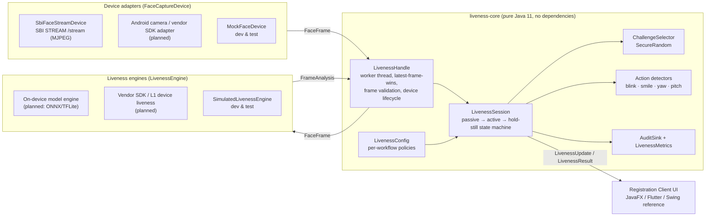
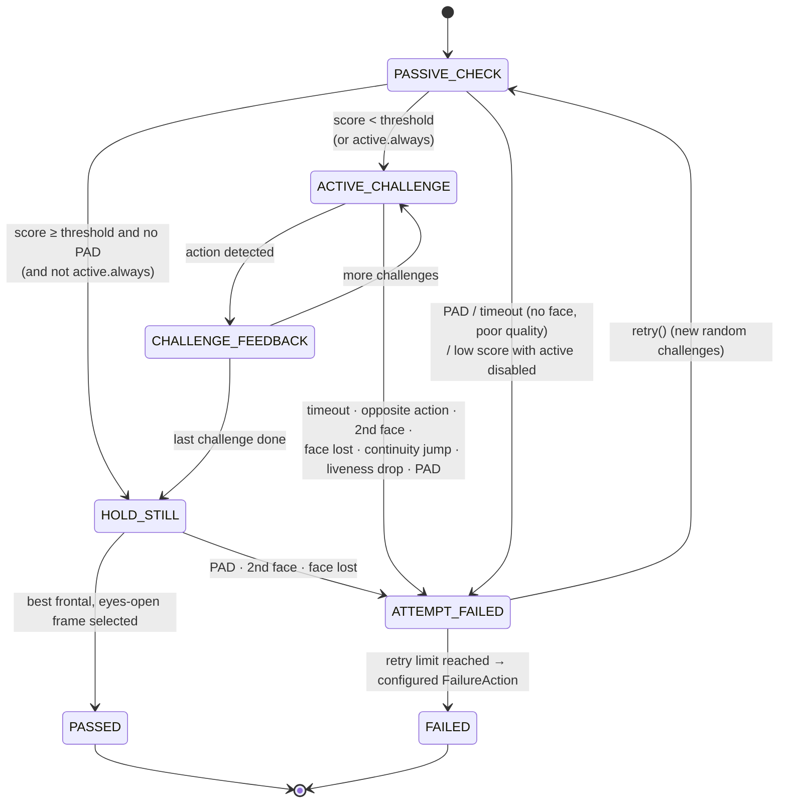
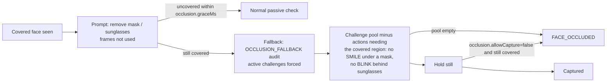
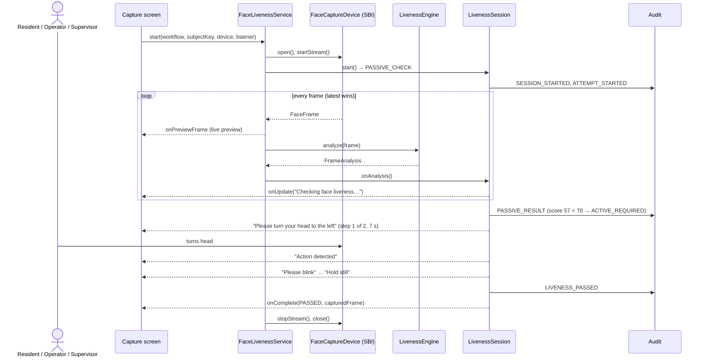

# Face Liveness and PAD for the MOSIP Registration Client: Technical Design (v0.1)

Problem statement 04, MOSIP Decode. This document covers the architecture implemented in this repository
and the integration plan for the Desktop and Android Registration Clients.

## 1. Goals

- Verify that the face presented during **resident face capture**, **operator authentication** and
  **supervisor authentication** belongs to a live person, and reject presentation attacks.
- **Hybrid** verification: passive liveness first (no user action). Escalate automatically to **active,
  randomly selected challenges** only when the passive confidence is below a configurable threshold.
- Work identically **online and offline**; stay **vendor neutral** (any compliant L0/L1 device, any
  liveness technology).
- Keep the person's experience simple: plain prompts, no exposed model details, clear retry and recovery.

## 2. Architecture

### Responsibilities

| Layer | Interface | Owns | Never does |
|---|---|---|---|
| Device adapter | `FaceCaptureDevice`, `FrameListener` | Transport, formats, connect/disconnect | Liveness decisions |
| Engine | `LivenessEngine` → `FrameAnalysis` | Per-frame measurements: faces, quality, eye openness, smile, head pose, passive score, PAD verdict + attack type | Thresholds, retries, prompts |
| Session | `LivenessSession` | Every decision: thresholds, challenge choice, timeouts, retries, failure handling | Pixel processing, I/O |
| Service | `FaceLivenessService`, `LivenessHandle` | Threading, backpressure, device lifecycle, error mapping | Policy |

The split means a new vendor needs only a device adapter, and a new liveness technology needs only an engine.
The security logic is written and tested once.

### Face frame streaming

- `FaceFrame` = device id, sequence, timestamp, size, `PixelFormat` (GRAY8/RGB24/BGR24/NV21/JPEG), bytes,
  optional device metadata (an L1 device may supply its own face box or quality).
- `SbiFaceStreamDevice` sends the SBI `STREAM /stream` request (`serialNo`, `deviceSubId`, `timeout`) to the
  local MDS. It parses the `multipart/x-mixed-replace` M-JPEG body (Content-Length or SOI/EOI framing, and
  chunked transfer encoding), reads JPEG dimensions from the SOF header, and reports a broken stream as
  `onStreamError` / `onStreamEnded`.
- The handle runs analysis on **one worker thread per session**. Only the **newest** pending frame is kept,
  so on slow (low-end Android) hardware latency stays bounded instead of a queue building up. Dropped frames
  are counted in metrics.
- Frames are validated structurally before analysis (exact byte length for raw formats; SOI/EOI for JPEG).
  Five consecutive bad frames fail the attempt with `INVALID_FRAME_DATA`. Three consecutive engine
  exceptions fail it with `ENGINE_ERROR`.

## 3. Passive-to-active decision flow

1. **Passive.** Collect `passive.minFrames` usable frames (exactly one face, quality ≥ `face.minQuality`).
   The passive score is a **trimmed mean** of per-frame scores, so a single outlier frame can't decide it. Frames
   with no face, several faces or poor quality produce live guidance ("Keep your face within the capture
   area", "Improve lighting") and do not count. The median expression and pose over these frames become the
   subject's **baseline**.
2. **Decision.** Score ≥ threshold → hold still and capture. Score below threshold → active challenges
   (or fail, if `active.enabled=false`). `active.always=true` forces challenges, e.g. for supervisors.
3. **Active.** Challenges are measured **relative to the baseline**: a blink must go open → closed → open,
   a head turn must reach N° from the resting pose, a smile must rise clearly above the person's
   resting expression. Detected → "Action detected" → next challenge.
4. **Hold still / capture.** The best frontal (|yaw|, |pitch| ≤ 12°), eyes-open, highest-quality frame
   from *after* verification becomes the captured biometric. The frame that is accepted is therefore one
   whose liveness was just verified.

### Dynamic challenge mechanism

- Pool = configured `active.challenges` ∩ challenges the engine reports it can verify.
- Count drawn uniformly in [`minChallenges`, `maxChallenges`] and order shuffled with **`SecureRandom`**.
  No repeats within a sequence. A retry avoids repeating the previous sequence.
- If the pool can't satisfy `minChallenges`, the session fails with `CONFIGURATION_ERROR` instead of
  silently weakening verification.

### Checks that run on every frame, in every phase

| Check | Defends against |
|---|---|
| Face must be inside the capture oval (`capture.area.*`) to count or be captured; leaving it during verification fails the attempt | capturing a bystander or a face held up at the edge of the view |
| PAD verdict (model + replay cues); `pad.minAttackFrames` flagged frames in an attempt reject it | print, screen, replay, mask |
| More than one face after passive → fail | an accomplice performing the action for a photo |
| Face-centre jump > 25 % of the frame between frames → fail | swapping media mid-session |
| Face out of view > 1.5 s once verification started → fail | swapping media off-camera |
| Smoothed liveness score must stay ≥ `active.minLivenessScore` | spoof that passes the gesture but not the model |
| Opposite action (turned right when asked left, after first returning to centre) → immediate fail | pre-recorded videos with random movement |

**Why the hybrid matters:** the simulated "video replay" (see tests) gets past the passive PAD model, but it
cannot follow 2–3 random prompts in random order, so it times out or performs the wrong action.

### Capture area

The oval on the capture screen is enforced, not decorative. `CaptureArea` (part of each workflow's policy)
is an ellipse in normalised coordinates of the unmirrored device frame, plus a centring tolerance and a
face-size range. For every frame the session asks where the face is:

| Position | Session behaviour | Guidance |
|---|---|---|
| `INSIDE` | Counts towards passive liveness, challenges and capture | — |
| `OFF_CENTER` | Ignored; during verification, > 1.5 s out fails with `FACE_NOT_POSITIONED` | "Keep your face within the capture area" |
| `TOO_FAR` / `TOO_CLOSE` | Same | "Move closer to the camera" / "Move back from the camera" |

PAD and the extra-face check still run on faces outside the oval. Moving away from the camera can't hide
an attack, and a second person anywhere in view still fails verification. The UI draws the same ellipse,
mapped onto the letterboxed, mirrored preview image, so the oval on screen matches the area being checked.

### Occlusion handling

The engine reports covered regions per face (`FaceObservation.getOccludedRegions()`: `EYES` for sunglasses
or tinted glasses, `LOWER_FACE` for a mask or scarf). The ONNX engine's `OcclusionAnalyzer` compares each
region with the subject's own skin (forehead/cheek reference), which keeps it fair across skin tones. A
texture test stops a full beard from counting as a mask. Clear prescription glasses are not reported.

Passive PAD is less reliable on a covered face, so a fallback never passes on the passive score alone.
For the resident biometric (`occlusion.allowCapture=false`) the final image must be uncovered, while
operator login can accept a covered face once liveness has been proven actively.

### Replay attack cues

`ReplayAttackDetector` adds three image cues to the MiniFASNet verdict for the primary face:

| Cue | What it measures | Weight |
|---|---|---|
| Moiré | Isolated peaks in the *whitened* spectrum of the inner face (camera aliasing a display's pixel grid); axes and JPEG 8×8 block harmonics excluded | 0.3 |
| Lighting uniformity | Coefficient of variation of the heavily blurred face luminance; a backlit display lacks 3D shading | 0.2 |
| Bezel / frame edges | Long straight edges (Hough) just outside the face on 2–4 sides, as from a phone, tablet or monitor bezel or a photo border | 0.5 |

The weighted suspicion lowers the bona fide score by up to 60%, so mild suspicion escalates to active
challenges. At 0.45 the frame is reported as an attack (`SCREEN_DISPLAY`, or `UNKNOWN` for a frame alone).
A full bezel alone, or strong moiré on flat lighting, reaches that threshold; uniform lighting alone never
can, because evenly front-lit registration desks also look flat. The indicators (`PadIndicator`) go to the
audit trail only. The thresholds are first estimates validated on synthetic images and must be calibrated
on recorded bona fide and attack sessions (§8).

### Rate limiting

`AttemptRateLimiter` counts failed attempts (those that use up a retry; device faults don't) **across
sessions**, per workflow and subject key: the operator or supervisor user ID, the registration ID, or the
whole station when no key is given. `rateLimit.maxFailures` failures within `rateLimit.windowMs` lock
face verification for `rateLimit.lockoutMs`. The current session ends with `LOCKED_OUT` (`BLOCK`), and
new sessions for that key are refused before any frame is analysed. With a store file, state survives a
client restart, so closing the application doesn't reset a lockout. Keys are stored only as SHA-256 hashes.

## 4. Workflow integration

| Workflow | Uses the result for | On final failure (`retry.exhaustedAction`, sample config) |
|---|---|---|
| Resident registration | `capturedFrame` becomes the face biometric (instead of a raw capture) | `REQUIRE_SUPERVISOR_OVERRIDE`: exception flow with supervisor review |
| Operator authentication | Face match runs on `capturedFrame`; login only if liveness **and** match pass | `ALLOW_ALTERNATE_AUTH`: password/OTP if the client's login policy allows it |
| Supervisor authentication | As operator, with a stricter policy (`active.always`, threshold 80, 1 retry) | `BLOCK` |

Integration points in the Registration Client:

- **Desktop (JavaFX):** wrap `FaceLivenessService` in a Spring bean. Use it from the existing face capture
  and biometric login/authentication controllers in place of the single-shot face capture. Marshal
  `LivenessListener` callbacks with `Platform.runLater`. Map `AuditSink` onto the existing audit manager so
  the events go out with the normal audit sync.
- **Localisation:** `LivenessMessages.forLanguage(code)` accepts the client's ISO 639-3 language codes
  (`eng`, `fra`, `ara`, …) and returns every prompt, status, failure and UI label in that language. It
  also reports whether the layout is right-to-left (Arabic). Bundles: English, French, Arabic, Hindi,
  Kannada, Tamil, Filipino, Amharic, Sinhala. They are UTF-8 files generated from one table
  (`tools/gen_liveness_messages.py`) and checked for completeness by tests. Translations are
  machine-assisted drafts and need native-speaker review before deployment.
- **Android (Flutter + Java):** `liveness-core` is plain Java 11 bytecode with no dependencies, so it runs
  unchanged in the Android client's native layer. A `MethodChannel`/`EventChannel` exposes `start`, `retry`
  and `cancel` and streams `LivenessUpdate` to the Flutter screen. A `CameraX`/vendor-SDK
  `FaceCaptureDevice` delivers NV21 frames. A TFLite engine implements `LivenessEngine`.

## 5. Configuration

All keys live under `mosip.registration.liveness.` and can be overridden per workflow
(`…resident.`, `…operator.`, `…supervisor.`). See [config/liveness.properties](../config/liveness.properties).

| Key | Default | Meaning |
|---|---|---|
| `enabled` | true | Master switch (disabled → capture without checks, outcome `LIVENESS_DISABLED`) |
| `passive.threshold` | 70 | Passive score (0–100) needed to skip challenges |
| `passive.minFrames` / `passive.timeoutMs` | 8 / 10000 | Passive window |
| `face.minQuality` | 40 | Minimum per-frame face quality |
| `pad.enabled` / `pad.minAttackFrames` | true / 2 | PAD enforcement |
| `active.enabled` / `active.always` | true / false | Active escalation policy |
| `active.challenges` | BLINK,SMILE,TURN_LEFT,TURN_RIGHT | Challenge pool (+ LOOK_UP, LOOK_DOWN) |
| `active.minChallenges` / `active.maxChallenges` | 2 / 3 | Challenges per attempt |
| `active.challengeTimeoutMs` | 7000 | Time per challenge |
| `active.minLivenessScore` | 40 | Smoothed score floor while performing challenges |
| `active.headYawDegrees` / `active.headPitchDegrees` | 20 / 15 | Required movement from baseline |
| `retry.max` | 2 | Retries after the first failure |
| `retry.exhaustedAction` | BLOCK | `BLOCK` · `REQUIRE_SUPERVISOR_OVERRIDE` · `ALLOW_ALTERNATE_AUTH` |
| `capture.holdStillMs` | 700 | Hold-still window for the final frame |
| `capture.area.enabled` | true | Enforce the capture oval |
| `capture.area.centerX` / `centerY` | 0.5 / 0.48 | Oval centre (normalised, unmirrored frame) |
| `capture.area.radiusX` / `radiusY` | 0.22 / 0.37 | Oval radii (normalised) |
| `capture.area.centerTolerance` | 0.45 | Allowed face-centre offset, as a fraction of the radii |
| `capture.area.minFill` / `maxFill` | 0.4 / 1.15 | Face width as a fraction of oval width (too far / too close) |
| `occlusion.enabled` | true | Detect and handle covered faces |
| `occlusion.graceMs` | 3000 | Time to uncover before falling back to region-safe active challenges |
| `occlusion.allowCapture` | false | Whether the final image may show a covered face |
| `rateLimit.enabled` | true | Lock out after repeated failures |
| `rateLimit.maxFailures` / `windowMs` / `lockoutMs` | 5 / 600000 / 900000 | Failures within the window that trigger a lockout, and its length |

Validation is strict: unknown keys (typos), out-of-range values and inconsistent combinations
(`active.always` without `active.enabled`, `minChallenges` > pool) fail at load time with the key named.

## 6. Error handling and recovery

| Condition | `FailureReason` | Counts against retries | User message |
|---|---|---|---|
| Device not found / connect fails / camera busy | `DEVICE_UNAVAILABLE`, `DEVICE_CONNECTION_FAILED`, `CAMERA_UNAVAILABLE` | No | Device not available + check connection |
| Stream broke / no frames | `DEVICE_DISCONNECTED` | No | same; Retry reconnects |
| Malformed frames (5 in a row) | `INVALID_FRAME_DATA` | No | same |
| Engine exceptions (3 in a row) | `ENGINE_ERROR` | No | generic |
| No face / several faces / poor quality | `FACE_NOT_DETECTED`, `MULTIPLE_FACES`, `POOR_FACE_QUALITY` | Yes | "We could not verify face liveness…" + specific tips |
| Face outside the oval or at the wrong distance | `FACE_NOT_POSITIONED` | Yes | "We could not see your face inside the oval…" |
| Face stayed covered and no fallback could verify or capture it | `FACE_OCCLUDED` | Yes | "Your face appears to be covered…" + remove mask / sunglasses |
| Low passive score, active disabled; score drop during challenges | `LIVENESS_BELOW_THRESHOLD` | Yes | same |
| Presentation attack | `PAD_ATTACK_DETECTED` | Yes | **generic** "Face verification could not be completed" (attack type only in audit) |
| Wrong action / continuity broken | `CHALLENGE_FAILED` | Yes | + "Follow the prompted action" |
| Challenge not done in time | `CHALLENGE_TIMEOUT` | Yes | same |
| Retry budget exhausted | `MAX_RETRIES_EXCEEDED` | n/a | Message for the configured `FailureAction` |
| Rate limit reached (this or earlier sessions) | `LOCKED_OUT` | terminal | "Too many unsuccessful attempts… temporarily locked", `BLOCK`, lockout end in `LivenessResult.getLockedUntil()` |
| Challenge pool unsatisfiable | `CONFIGURATION_ERROR` | terminal | generic, `BLOCK` |

Faults that are not the person's doing never use up their attempts. Retry after a device fault re-opens the stream.

## 7. Security and privacy

- **No biometric data leaves the session**: audit records carry decisions, scores, challenge names and
  reasons only (no images, templates or landmarks). Metrics are anonymous counters.
- **Least disclosure to the user**: PAD failures show a generic message. Attack type and scores are only
  in audit/diagnostics, so an attacker learns nothing about what the detector saw.
- **Unpredictability**: `SecureRandom` count and order; no repeats; a different sequence on retry.
- **Brute-force resistance**: failed attempts are rate limited across sessions per subject, with lockout
  state persisted (hashed keys) so a restart does not clear it. Audit events `OCCLUSION_FALLBACK`
  (REG-LIV-013) and `RATE_LIMIT_LOCKOUT` (REG-LIV-014) record fallbacks and lockouts.
- **Fail closed**: engine/device faults never produce a pass; an unsatisfiable policy is a hard failure;
  unknown config keys are rejected.
- **Offline parity**: engine, challenge generation and action validation are all local; the network is
  never consulted for a liveness decision.
- **Model and config integrity (planned)**: model packages are distributed through the client's existing
  sync, accompanied by a signed manifest (SHA-256 + signature verified against the client's trusted key).
  The engine refuses to load an unverified model, and the model version is recorded in every
  `SESSION_STARTED` audit event (`EngineInfo.modelVersion`).
- **Device trust**: SBI L0/L1 signing of the final `/capture` response still applies. Liveness adds a check
  on the presentation itself, not on device authenticity.

## 8. ISO/IEC 30107 alignment

- **Terminology (30107-1)**: `AttackType` follows PAI species (printed photo, screen display, video
  replay, mask). The PAD subsystem is the engine; the challenge-response layer adds system-level resistance.
- **Evaluation (30107-3)** plan for a chosen engine:
  - Bona fide and attack presentation sets per PAI species, captured on the target L0/L1 devices,
    lighting and demographics.
  - Report **APCER per PAI species** (worst case across species), **BPCER** at the configured
    `passive.threshold`, and DET curves to choose thresholds per workflow.
  - System-level test with challenges enabled: report the impostor attack presentation accept rate (**IAPAR**) for replay attacks.
  - Track **BPCER impact on UX**: % of bona fide sessions escalated to active, retry rate, completion time
    (already emitted by `LivenessMetrics`).
- **ISO/IEC 19794-5**: the captured frame is chosen for frontal pose, open eyes and highest quality, in line with
  the face image format's capture requirements. ICAO-grade quality checks belong to the engine's quality score.

## 9. Testing

106 automated tests across `liveness-core` and `liveness-onnx-engine` (`build.ps1` / `build.sh` / `mvn verify`):

- **Session (deterministic, virtual clock):** passive-only pass; low score → random challenges → pass;
  `active.always`; unresponsive subject exhausts retries with the configured action; printed photo
  rejected by PAD with a generic message; video replay that evades passive PAD stopped by challenges;
  opposite head turn; second face during challenge; no face; poor quality; passive-only policy; liveness
  disabled; device faults don't consume retries; unsupported challenges → configuration error; cancel;
  challenge variation across retries; audit payload size.
- **Service (real threads):** live pass with device release; disconnect mid-session + retry; unavailable
  device recovers; persistent engine errors; corrupt frames tolerated.
- **SBI adapter:** fake local SBI server (STREAM request body, multipart, chunked, HTTP errors, unreachable).
- **Unit:** challenge selection randomness and constraints; blink/smile/head-pose detectors; config parsing.
- **Capture area:** geometry and validation; a face beside the oval, too far or too close is never captured;
  moving into the oval passes; drifting out during a challenge fails with `FACE_NOT_POSITIONED`.
- **Occlusion:** prompts for mask/sunglasses; uncovering in time avoids the fallback; persistent mask or
  sunglasses → active challenges without SMILE/BLINK; covered resident face is not captured.
- **Rate limiting:** window and lockout, persistence across restart, hashed store, cross-session lockout
  refusing new sessions, device faults not counted.
- **Localisation:** every bundle has exactly the message keys, prompts are translated, MOSIP codes and
  fallback, RTL, `MessageFormat` labels, PAD failures stay generic in every language.
- **Engine cues (synthetic images, OpenCV):** moiré grating, flat vs shaded lighting, phone bezel, JPEG grid
  exclusion, verdict combination; occlusion for mask, sunglasses, both, beard (not a mask), darker skin tone.

The mock device plus `SimulatedSubject` (live / photo / screen / replay / nobody / two people; placement in
the frame; mask or sunglasses; cooperative / unresponsive / wrong action) is the automated liveness and PAD scenario framework from the bonus tasks.

## 10. Roadmap

| Version | Scope |
|---|---|
| **v0.1 (this)** | Core orchestration, config, audit/metrics, SBI stream adapter, mock device + simulated engine, reference UI, tests |
| v0.2 | Real on-device engine: face landmarks (eye openness, smile, pose) + passive anti-spoof CNN via ONNX Runtime (desktop) / TFLite (Android); calibration of thresholds |
| v0.3 | JavaFX integration in the Desktop client (resident capture, operator/supervisor auth); MDS device discovery |
| v0.4 | Android adapter (CameraX/vendor SDK), Flutter UI, low-resource optimisations (frame skipping, NNAPI/GPU delegate) |
| v0.5 | Signed model packages + version management, ISO/IEC 30107-3 evaluation report |
