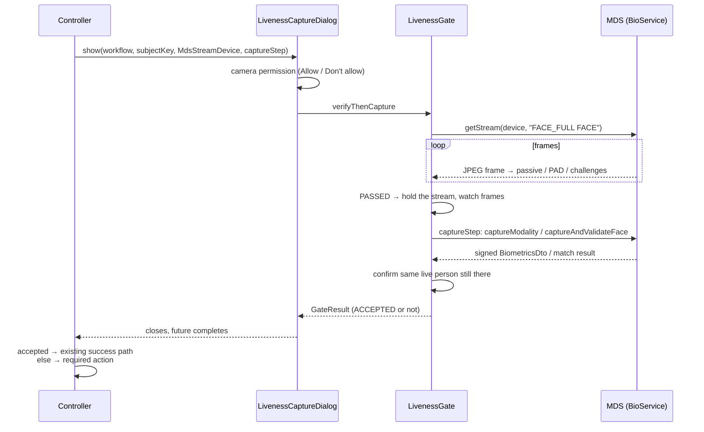

# Desktop Registration Client integration

How face liveness is wired into the MOSIP Desktop Registration Client (`mosip/registration-client`, JavaFX +
Spring). Line numbers refer to commit `22fe01f` (master, 2026-03-17).

The integration code lives in [`liveness-regclient`](../liveness-regclient). It compiles and is tested in this
repository. The controller changes below are applied in the client repository; they have not been compiled against
it here, because building the client needs the MOSIP kernel artifacts.

## Why liveness gates the capture instead of replacing it

The client never stores a preview frame. The face in the registration packet is the MDS-signed `rCapture` result
(`bioService.captureModality`), and operator and supervisor authentication match a fresh capture
(`captureAndValidateFace`, `SessionContext.create`). So liveness cannot just hand over its own frame. Instead,
[`LivenessGate`](../liveness-core/src/main/java/io/mosip/registration/liveness/gate/LivenessGate.java):

1. Runs the liveness session (passive, PAD, random active challenges) on the MDS stream.
2. Only if it passes, runs the screen's existing capture step.
3. Keeps the stream open while that capture runs, and checks every frame the same way the session does (PAD, one
   face only, no face loss over 1.5 s, face within `capture.bind.maxFaceShift` of where liveness was verified).
4. After the capture returns, requires one more bona fide frame of the same person, so the capture is bracketed
   even by a device that pauses its stream while capturing.

If any of these fail, the capture is discarded (`GateStatus.BINDING_BROKEN`). The failure is audited and counts
towards the rate limit, and the person sees the generic "Face verification could not be completed" message.



## 1. Dependencies

Add `liveness-core`, `liveness-regclient` and an engine (`liveness-onnx-engine`) to
`registration/registration-client/pom.xml`. The client already has JavaFX, so `liveness-regclient`'s
`javafx-controls` dependency can be excluded or given `provided` scope. The demo package and its
`liveness-camera` dependency are not needed in the client.

## 2. Spring bean

```java
@Configuration
public class FaceLivenessConfig {

    @Bean(destroyMethod = "close")
    public RegClientLiveness faceLiveness(AuditManagerService auditManagerService) throws Exception {
        LivenessConfig config = RegClientLivenessConfig.fromApplicationMap(ApplicationContext.map());
        LivenessEngine engine = new OnnxLivenessEngine(new ModelRepository(modelsDir, verifier).activate());
        AuditSink audit = new RegClientAuditSink((event, component, refId, refIdType) ->
                auditManagerService.audit(AuditEvent.valueOf(event), Components.valueOf(component), refId, refIdType));
        RegClientLiveness liveness = new RegClientLiveness(config, engine, audit,
                Paths.get(".mosipkeys", "liveness-attempts.dat"));
        liveness.setConnectivity(RegistrationAppHealthCheckUtil::isNetworkAvailable);
        // While online, look for a newer signed model package every 6 hours; used from the next start.
        liveness.startModelSync(new ModelSync(URI.create(modelUpdateUrl), repository, verifier,
                modelsDir.resolve("downloads")), 360);
        return liveness;
    }
}
```

- **Configuration:** comes from `ApplicationContext.map()`, the global parameters the client syncs from the server's
  `registration-default.properties` and keeps in its local DB. An online sync delivers new values; an offline
  client keeps enforcing the last ones. Unknown or invalid `mosip.registration.liveness.*` keys stop the client
  instead of silently weakening the policy. See [config/liveness.properties](../config/liveness.properties) for
  every key.
- **Models:** run from a signed package (`ModelRepository` + `ModelPackageVerifier`). A package that fails
  verification is never loaded. `startModelSync` fetches newer packages only while the connectivity check says
  online; forged or replayed packages are refused before any model is downloaded, and offline nothing changes.
- **Connectivity:** only drives the screen's online/offline badge and model sync, never a liveness decision.
- **Rate limits:** lockouts persist across restarts in the given file. It stores hashed keys only.

## 3. Audit events

Add one constant per liveness event to `io.mosip.registration.constants.AuditEvent`. `RegClientAuditSink`
resolves them as `REG_LIVENESS_<AuditEventType>`. The reference ID is the liveness session ID, with type
`LIVENESS_SESSION_ID`. Event details (scores, failure reasons, which binding check failed) go to the application
log, never to the screen, and no event carries image data.

```java
REG_LIVENESS_SESSION_STARTED("REG-LIV-001", SYSTEM_EVENT.getCode(), "REG_LIVENESS_SESSION_STARTED", "Face liveness: session started"),
REG_LIVENESS_ATTEMPT_STARTED("REG-LIV-002", SYSTEM_EVENT.getCode(), "REG_LIVENESS_ATTEMPT_STARTED", "Face liveness: attempt started"),
REG_LIVENESS_PASSIVE_RESULT("REG-LIV-003", SYSTEM_EVENT.getCode(), "REG_LIVENESS_PASSIVE_RESULT", "Face liveness: passive result"),
REG_LIVENESS_CHALLENGE_ISSUED("REG-LIV-004", SYSTEM_EVENT.getCode(), "REG_LIVENESS_CHALLENGE_ISSUED", "Face liveness: challenge issued"),
REG_LIVENESS_CHALLENGE_PASSED("REG-LIV-005", SYSTEM_EVENT.getCode(), "REG_LIVENESS_CHALLENGE_PASSED", "Face liveness: challenge passed"),
REG_LIVENESS_CHALLENGE_FAILED("REG-LIV-006", SYSTEM_EVENT.getCode(), "REG_LIVENESS_CHALLENGE_FAILED", "Face liveness: challenge failed"),
REG_LIVENESS_PAD_ATTACK_DETECTED("REG-LIV-007", SYSTEM_EVENT.getCode(), "REG_LIVENESS_PAD_ATTACK_DETECTED", "Face liveness: presentation attack detected"),
REG_LIVENESS_ATTEMPT_FAILED("REG-LIV-008", SYSTEM_EVENT.getCode(), "REG_LIVENESS_ATTEMPT_FAILED", "Face liveness: attempt failed"),
REG_LIVENESS_LIVENESS_PASSED("REG-LIV-009", SYSTEM_EVENT.getCode(), "REG_LIVENESS_LIVENESS_PASSED", "Face liveness: passed"),
REG_LIVENESS_LIVENESS_FAILED("REG-LIV-010", SYSTEM_EVENT.getCode(), "REG_LIVENESS_LIVENESS_FAILED", "Face liveness: failed"),
REG_LIVENESS_SESSION_CANCELLED("REG-LIV-011", USER_EVENT.getCode(), "REG_LIVENESS_SESSION_CANCELLED", "Face liveness: cancelled"),
REG_LIVENESS_SYSTEM_ERROR("REG-LIV-012", SYSTEM_EVENT.getCode(), "REG_LIVENESS_SYSTEM_ERROR", "Face liveness: device or engine error"),
REG_LIVENESS_OCCLUSION_FALLBACK("REG-LIV-013", SYSTEM_EVENT.getCode(), "REG_LIVENESS_OCCLUSION_FALLBACK", "Face liveness: covered face, fallback challenges"),
REG_LIVENESS_RATE_LIMIT_LOCKOUT("REG-LIV-014", SYSTEM_EVENT.getCode(), "REG_LIVENESS_RATE_LIMIT_LOCKOUT", "Face liveness: locked after repeated failures"),
REG_LIVENESS_CONSENT_GRANTED("REG-LIV-015", USER_EVENT.getCode(), "REG_LIVENESS_CONSENT_GRANTED", "Face liveness: camera permission given"),
REG_LIVENESS_CONSENT_NOT_GIVEN("REG-LIV-016", USER_EVENT.getCode(), "REG_LIVENESS_CONSENT_NOT_GIVEN", "Face liveness: camera permission refused"),
REG_LIVENESS_CAPTURE_BOUND("REG-LIV-017", SYSTEM_EVENT.getCode(), "REG_LIVENESS_CAPTURE_BOUND", "Face liveness: capture tied to the verified person"),
REG_LIVENESS_CAPTURE_BINDING_BROKEN("REG-LIV-018", SYSTEM_EVENT.getCode(), "REG_LIVENESS_CAPTURE_BINDING_BROKEN", "Face liveness: person changed during capture"),
REG_LIVENESS_CAPTURE_FAILED("REG-LIV-019", SYSTEM_EVENT.getCode(), "REG_LIVENESS_CAPTURE_FAILED", "Face liveness: device capture failed"),
REG_LIVENESS_CAMERA_SOURCE_CHECKED("REG-LIV-020", SYSTEM_EVENT.getCode(), "REG_LIVENESS_CAMERA_SOURCE_CHECKED", "Face liveness: station cameras listed"),
REG_LIVENESS_INJECTION_DETECTED("REG-LIV-021", SYSTEM_EVENT.getCode(), "REG_LIVENESS_INJECTION_DETECTED", "Face liveness: injected frames or virtual camera"),
```

Components: resident capture uses `REG_BIOMETRICS`, operator login uses `LOGIN`, and supervisor
authentication uses `REG_OS_AUTH`.

## 4. Controller changes

Every screen follows the same pattern. Build an `MdsStreamDevice` over the client's own stream, open
`LivenessCaptureDialog` with the screen's existing capture call as the capture step, and continue on the existing
success path only when `GateResult.isAccepted()`. The `Streamer` preview is not started for the face; the dialog
shows its own preview with the capture oval.

A shared helper avoids repeating it:

```java
// In BaseController (or a small @Component)
@Autowired private RegClientLiveness faceLiveness;

protected <T> void verifyFaceThen(LivenessWorkflow workflow, String subjectKey, MdmBioDevice mdm, String title,
                                  CaptureStep<T> capture, Consumer<GateResult<T>> done) {
    MdsStreamDevice device = MdsStreamDevice.forMds(mdm.getDeviceId(), mdm.getDeviceMake(), mdm.getDeviceModel(),
            mdm.getSerialNumber(), mdm.getCertification(), mdm.getFirmWare(),
            () -> bioService.getStream(mdm, RegistrationConstants.FACE_FULLFACE));
    LivenessCaptureDialog.show(fXComponents.getStage(), title, faceLiveness, workflow, subjectKey, device, capture,
                    LivenessMessages.forLanguage(ApplicationContext.applicationLanguage()))
            .thenAccept(r -> Platform.runLater(() -> done.accept(r)));
}
```

`mdm` comes from `deviceSpecificationFactory.getDeviceInfoByModality(RegistrationConstants.FACE_FULLFACE)`, the
same lookup the controllers already do.

### 4.1 Resident face capture: `GenericBiometricsController.scan` (line 429)

In `deviceSearchTask.setOnSucceeded`, before `bioService.getStream(...)` (line 480), route the face through
liveness. Move the body of `rCaptureTaskService.setOnSucceeded` (lines 597-651, the `try`/`finally` after `rCaptureTaskService.getValue()`) into a method
`handleCaptured(List<BiometricsDto>)` so that both paths share it.

```java
if (isFace(currentModality) && faceLiveness.isEnabled(LivenessWorkflow.RESIDENT_REGISTRATION)) {
    SessionContext.setAutoLogout(false);
    verifyFaceThen(LivenessWorkflow.RESIDENT_REGISTRATION, getRegistrationDTOFromSession().getRegistrationId(),
            mdmBioDevice, "Face capture",
            () -> rCapture(fxControl.getUiSchemaDTO().getId(), currentModality),   // the existing MDS rCapture
            r -> {
                SessionContext.setAutoLogout(true);
                disableEnableBiometricPane(false);
                if (r.isAccepted()) {
                    handleCaptured(r.getCapture());          // local de-dup, attempts, save to RegistrationDTO
                } else if (r.getLiveness() != null
                        && r.getLiveness().getRequiredAction() == FailureAction.REQUIRE_SUPERVISOR_OVERRIDE) {
                    // Retries exhausted: mark the face as an exception (as the exception checkbox pane does);
                    // the supervisor then approves it in the isReviewer authentication.
                }
            });
    return;
}
```

The exception photo (`isExceptionPhoto`) can use the same call. A face that fails liveness is never added to
`RegistrationDTO`.

### 4.2 Operator authentication: `AuthenticationController.executeFaceValidationTask` (line 515)

This also covers the supervisor (reviewer) authentication on the same screen (`isReviewer`, line 638). Replace
the `Service<Boolean>` with the gate. The capture step is the existing `captureAndValidateFace`, which captures
and matches the face.

```java
private void executeFaceValidationTask(String userId, GridPane pane) {
    pane.setDisable(true);
    LivenessWorkflow workflow = isReviewer ? LivenessWorkflow.SUPERVISOR_AUTHENTICATION
                                           : LivenessWorkflow.OPERATOR_AUTHENTICATION;
    MdmBioDevice mdm = deviceSpecificationFactory.getDeviceInfoByModality(RegistrationConstants.FACE_FULLFACE);
    verifyFaceThen(workflow, userId, mdm, "Face authentication",
            () -> captureAndValidateFace(userId, true, isReviewer),
            r -> {
                pane.setDisable(false);
                if (r.isAccepted() && Boolean.TRUE.equals(r.getCapture())) {
                    // existing success path, lines 554-562 (addOSIData ... loadNextScreen)
                } else if (r.getLiveness() != null
                        && r.getLiveness().getRequiredAction() == FailureAction.ALLOW_ALTERNATE_AUTH) {
                    // offer the next configured auth mode (password / OTP) if the auth policy allows it
                } else {
                    operatorAuthContinue.setDisable(true);
                    genericController.disableAuthenticateButton(true);
                }
            });
}
```

The `startStream()` method (line 484) is no longer called for the face.

### 4.3 Supervisor authentication: `EODAuthenticationController.executeFaceValidationTask` (line 627)

This is the same change as 4.2, with workflow `SUPERVISOR_AUTHENTICATION` and the existing
`captureAndValidateFace(userId, false, false)`. The supervisor policy (sample config) always requires an active
challenge, raises the passive threshold to 80, allows one retry, and blocks after that.

### 4.4 Operator login: `LoginController.captureFace` (line 660)

Replace `executeValidationTask(...)` for the face mode with the gate. The capture step is the existing
`SessionContext.create(userDTO, RegistrationConstants.FACE, false, false, authenticationValidatorDTO)`, which
captures and validates the face. On an accepted result with `true`, continue as `executeValidationTask`'s
`onSucceeded` does. Use the operator ID as the subject key, so repeated failures lock that operator's face login
across restarts without locking other operators.

## 5. What the person sees

[`LivenessCaptureDialog`](../liveness-regclient/src/main/java/io/mosip/registration/liveness/regclient/ui/LivenessCaptureDialog.java)
and [`LivenessCaptureView`](../liveness-regclient/src/main/java/io/mosip/registration/liveness/regclient/ui/LivenessCaptureView.java)
are the same on all three screens:

- **Before the camera:** a camera permission prompt. "Don't allow" is the default, and closing the window counts
  as a refusal. A refusal is audited and the camera stays off.
- **Preview:** a mirrored live preview with the capture oval the session enforces. The oval's colour follows
  the state, and arrows show turn directions.
- **Status text:** "Checking face liveness…", then the challenge prompt with its step ("Challenge 1 of 2"), a
  countdown and attempts. While the device capture runs, "Hold still".
- **After a failed attempt:** guidance tips and Retry. After the last attempt, what happens next (supervisor
  exception, alternate login, or blocked). A lockout shows when it ends.
- **PAD and binding failures:** only the generic message. Detail goes to the audit trail and log.
- **Online/offline:** a badge, refreshed every 2 s, reads "● Online" or "● Offline · the same liveness checks
  apply", above "Checked on this device · works offline". Liveness does the same thing online and offline.
- **Language:** the client language, including right-to-left layout for Arabic.

## 6. Try it without the client

```powershell
.\build.ps1 -Run -RegClient -Sim     # mock device, simulated person; try "During capture: Holds up a printed photo"
.\build.ps1 -Run -RegClient          # webcam + ONNX engine
.\build.ps1 -Run -RegClient -Device sbi:auto
```

The demo ([`RegClientDemoApp`](../liveness-regclient/src/main/java/io/mosip/registration/liveness/regclient/demo/RegClientDemoApp.java))
has three tabs standing in for operator login, resident biometrics and supervisor approval. Each opens the dialog
the way the patched controllers do. The client's MDS capture and face match are simulated. Diagnostic mode shows
the `AuditManagerService.audit(...)` calls the client would make.

## Limits

- The controller changes above are not compiled against the client in this repository.
- Capture binding watches the MDS preview stream. A device that stops streaming during `rCapture` is still
  covered by the confirmation frame after the capture, but not continuously during it. On-device PAD in an L1
  device would close that gap.
- `captureAndValidateFace` and `SessionContext.create` open their own capture inside the step. If an MDS cannot
  stream and capture at the same time, set `mosip.registration.liveness.capture.bind.enabled=false` for that
  workflow. Liveness still runs first, but the capture is then not watched.
