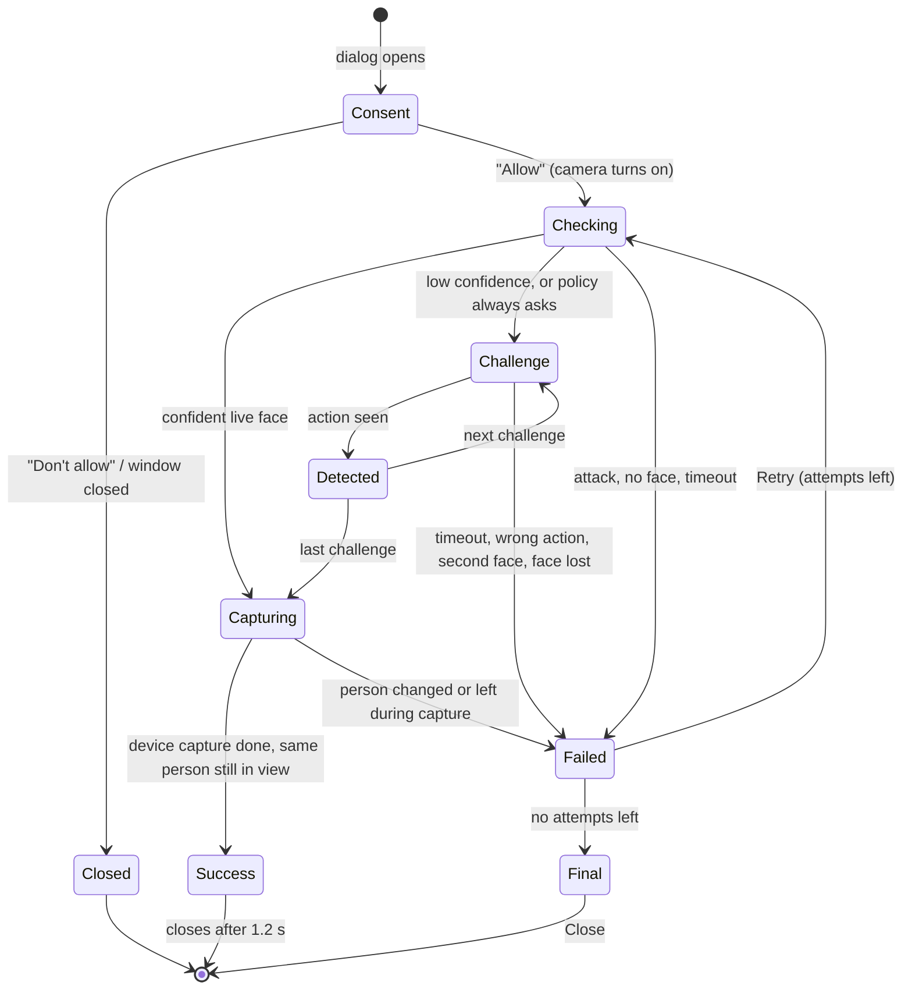

# Face Liveness: UI/UX Design

The face liveness screens for resident face capture, operator authentication and supervisor authentication, on
the Desktop Registration Client (implemented: `liveness-regclient`) and the Android Registration Client
(designed here; the Flutter screen is not built yet). The behaviour is driven by one shared session, so the
three screens and both platforms show the same states, messages and choices.

The principles, from the problem statement:

- **Nothing to choose.** The client picks every challenge; the person only follows prompts.
- **Simple and plain.** One instruction at a time in large type, with a secondary hint below it.
- **No model internals.** Scores, thresholds, attack types and model names never appear on the capture screen.
  They go to the audit trail and the diagnostics view only.
- **Clear recovery.** Every failure says what to do next: retry with a tip, or the workflow's recovery path.

## 1. Screen layout

One dialog serves all three workflows. Only the window title, the capture step and the policy differ.

```
┌──────────────────────────────────────────────────────────────────────────────────┐
│ Face capture                                                                      │
├──────────────────────────────────────────────┬───────────────────────────────────┤
│                                              │ Please turn your head to the left │  instruction (bold 20 pt)
│        live preview, mirrored (480x360)      │ Please continue                   │  guidance (14 pt, muted)
│                                              │                                   │
│               ╭───────────╮                  │ Challenge 1 of 2                  │  step
│      ◀        │           │                  │ Time left: 6 s                    │  countdown
│               │   face    │                  │ ▓▓▓▓▓▓▓▓▓░░░░░░░░░░               │  progress
│               │           │                  │ Attempt 1 of 3                    │  attempts
│               ╰───────────╯                  │                                   │
│           capture oval (dashed)              │ • tips after a failed attempt     │
│                                              │                                   │
│                                              │ ● Online                          │  connectivity badge
│                                              │ (Checked on this device · works   │  on-device note
│                                              │  offline)                         │
├──────────────────────────────────────────────┴───────────────────────────────────┤
│                                                              [ Retry ]  [ Cancel ]│
└──────────────────────────────────────────────────────────────────────────────────┘
```

- **Preview.** The device stream, mirrored like a selfie camera, so "turn left" moves the face to the left of
  the screen. The preview is never flipped for right-to-left languages.
- **Capture oval.** Drawn from the same configuration (`capture.area.*`) that the session enforces, so what
  the person sees is exactly the area that counts. A face outside it, too far or too close gets a positioning
  hint instead of counting.
- **Direction arrows** appear beside the oval for turn left/right and look up/down.
- **Status column.** It fills top-down and empties when a line no longer applies, so the layout never jumps.
- **Retry** is enabled only when a retry is actually available. **Cancel** becomes **Close** once the session
  has ended.

### Colours

Colour always repeats what the text says. It is never the only signal.

| State | Oval | Instruction text |
|---|---|---|
| Waiting, checking liveness | light grey `#DDE3E8` | dark `#1F2933` |
| Active challenge | amber `#F5A623` | dark amber `#B86E00` |
| Action detected, hold still, passed | green `#2ECC71` | dark green `#1E8E4E` |
| Attempt failed, final failure | red `#E74C3C` | dark red `#C0392B` |

The preview background is `#1D2329`, and the oval colours are drawn on it. On the light status column, the
instruction colours meet WCAG AA for large text (the instruction is bold 20 pt): amber 4.0:1, green 4.2:1 and
red 5.4:1 against white. Smaller text is dark or muted grey (6.4:1).

## 2. Screen flow



| Step | What the person sees | Notes |
|---|---|---|
| **Camera permission** | "Camera permission" panel with the notice text, **Allow** and **Don't allow**. "Don't allow" is the default button. | The camera stays off until "Allow". Closing the window counts as a refusal. Asked again on retry if the answer is older than `consent.maxAgeMs`. Audited either way. |
| **Checking** | "Checking face liveness…", grey oval, progress bar filling. Positioning hints as needed. | No action needed. A confidently live face goes straight to capture without any challenge. |
| **Challenge** | "Please blink" (or smile, turn left/right, look up/down), amber oval, direction arrow, "Challenge 1 of 2", countdown, "Please continue" once movement starts. | 2–3 challenges in random order. A retry gets a different sequence. |
| **Action detected** | "Action detected", green oval, for 0.6 s. | Then the next challenge. |
| **Hold still / capturing** | "Hold still". | The device's own capture (MDS rCapture or face match) runs now. The person must stay in the oval, alone and bona fide, until it returns. |
| **Success** | "Good, face captured successfully", green. | Window closes after 1.2 s and the screen continues. |
| **Attempt failed** | The failure message in red, tips as bullets, "Press "Retry" to try again.", **Retry** enabled. | |
| **Final failure** | The workflow's recovery message (section 4), **Retry** disabled, **Close**. For a lockout, "Locked until 14:32". | |

### Positioning and quality hints

Shown as the secondary line while checking or during a challenge, whenever they apply.

| Situation | Hint |
|---|---|
| No face | Keep your face within the capture area |
| Face outside the oval | Keep your face within the capture area |
| Too far / too close | Move closer to the camera / Move back from the camera |
| Two or more faces | Make sure only one face is visible to the camera |
| Poor quality or dark | Improve lighting |
| Mask or scarf | Please remove any mask or scarf covering your face |
| Sunglasses | Please remove sunglasses or tinted glasses |
| Challenge movement started | Please continue |

If a face stays covered past `occlusion.graceMs`, the session continues with challenges that don't need the
covered part (no smile behind a mask, no blink behind sunglasses), and the final image must still be uncovered
unless the policy allows it (operator login does).

## 3. Messages

The person only ever sees these messages. Each has a key for translation; the English text is the default.

| When | Message |
|---|---|
| Checking | Checking face liveness… |
| Challenges | Please blink · Please smile · Please turn your head to the left · Please turn your head to the right · Please look up · Please look down |
| Feedback | Please continue · Action detected · Hold still |
| Success | Good, face captured successfully |
| Could not verify liveness (timeout, wrong action, no face, low score) | We could not verify face liveness. Please try again. |
| Face outside the oval | We could not see your face inside the oval. Please try again. |
| Face stayed covered | Your face appears to be covered. Please uncover your face and try again. |
| **Presentation attack, injection, capture binding broken** | **Face verification could not be completed. Please try again.** |
| Device unavailable, disconnected, bad frames, capture failed | The face capture device is not available. Please try again. |
| Camera not trusted (virtual camera present) | This camera cannot be used for face verification. Please use the approved face capture device. |
| Permission refused | Face capture cannot continue without permission to use the camera. |
| Cancelled | Face capture was cancelled. |

Failure tips (bulleted under the message): Look directly at the camera · Ensure your face is clearly visible ·
Improve lighting · Keep your face within the capture area · Follow the prompted action · Check that the face
capture device is connected.

**A presentation attack gets the generic message on purpose.** Telling an attacker "photo detected" or "screen
detected" teaches them what to change. The attack type, scores and detection cues are recorded in the audit
trail (`PAD_ATTACK_DETECTED`, `INJECTION_DETECTED`) and shown only in the diagnostics view.

**Languages.** All texts and labels come in English, French, Arabic, Hindi, Kannada, Tamil, Filipino, Amharic
and Sinhala, following the client's language. Arabic lays out the status column and permission panel
right-to-left. The translations are machine-assisted drafts and need native-speaker review before deployment.

## 4. The three workflows

The screen is the same; the title, capture step and policy differ.

| | Resident face capture | Operator authentication / login | Supervisor authentication |
|---|---|---|---|
| Opened from | Biometrics screen, face modality | Login and operator authentication screens | End-of-day approval and reviewer authentication |
| Title | Face capture | Face authentication | Face authentication |
| Challenges | Only if the passive check is unsure | Only if the passive check is unsure | **Always** (`active.always`), 2–3, all six types in the pool |
| Passive threshold | 70 | 70 | **80** |
| Attempts | 3 | 3 | **2** |
| Capture step after liveness | MDS rCapture (the stored biometric) | Capture and match against the operator's enrolled face | Capture and match against the supervisor's enrolled face |
| After the last attempt | "Face capture could not be completed. Supervisor review is required to continue." The face is marked as an exception for supervisor approval. | "Face verification could not be completed. Please use an alternate authentication method." The screen offers password/OTP if the auth policy allows. | "Face verification could not be completed. Please contact your administrator." Blocked. |
| Lockout key | Registration ID | Operator user ID | Supervisor user ID |
| Lockout | 8 failures in 10 min → locked 15 min | 5 failures in 10 min → locked 15 min | 3 failures in 10 min → locked 15 min |

The values are the sample configuration (`config/liveness.properties`); every one is configurable per workflow.

## 5. Devices and errors

- **Device unavailable or unplugged.** "The face capture device is not available. Please try again." with the
  tip "Check that the face capture device is connected". **Retry** reconnects. Device faults never use up an
  attempt or count towards a lockout, since they aren't the person's doing.
- **Device busy just after a stop.** Retried silently for up to 1.5 s before it is reported.
- **Software camera on the station** (OBS, ManyCam and similar, when the policy blocks them): the camera
  is not opened, and the camera-not-trusted message is shown. SBI devices are trusted through the MDS.
- **Engine error.** The generic message. Detail goes to the log.

## 6. Online and offline

Liveness runs entirely on the device, so online and offline look and behave the same. The screen says so
rather than leaving the operator to wonder:

- A permanent note: "Checked on this device · works offline".
- A badge, refreshed every 2 s: "● Online" (green) or "● Offline · the same liveness checks apply" (grey).
  It is hidden until the client reports its connectivity.
- Model updates download in the background when online and are verified before use. Nothing about this is
  shown to the person being captured.

## 7. Diagnostics (operators and testers only)

The demo apps have a **Diagnostics** toggle showing the audit trail (session, attempts, passive score and
decision, challenges, PAD and injection detail) and the engine's per-frame readout (eye openness, smile,
pitch, replay cues). The production capture dialog has no diagnostics. The same information is in the
Registration Client's audit table.

## 8. Android (designed, not built)

The Android Registration Client is Flutter on top of a Java layer. The liveness core runs in the Java layer
unchanged, and the Flutter screen should look and behave like the desktop one.

**Layout.** Portrait, so the preview goes on top and the status below:

```
┌────────────────────────────┐
│ Face capture          ✕    │
├────────────────────────────┤
│   live preview (front      │
│   camera, mirrored)        │
│        ╭────────╮          │
│   ◀    │  face  │          │
│        ╰────────╯          │
├────────────────────────────┤
│ Please turn your head      │
│ to the left                │
│ Please continue            │
│ Challenge 1 of 2 · 6 s     │
│ ▓▓▓▓▓▓▓▓░░░░░░░░           │
│ Attempt 1 of 3   ● Online  │
│ Checked on this device     │
├────────────────────────────┤
│   [ Retry ]   [ Cancel ]   │
└────────────────────────────┘
```

**Data from the bridge.** `FlutterLivenessBridge` streams each update as a map, and the screen draws only from
it:

| Screen element | Bridge field |
|---|---|
| Instruction, hint | `messageCode`, `guidanceCode` (translate in Flutter with the same keys); `message`, `guidance` (English fallback) |
| Oval and arrows | `captureArea` (`centerX`, `centerY`, `radiusX`, `radiusY`), `state`, `challenge` |
| Step, countdown, progress | `challengeNumber`, `challengeCount`, `remainingMs`, `progress` |
| Attempts, Retry | `attempt`, `maxAttempts`, `retryAvailable` |
| Tips | `tips` |
| Final result | `outcome`, `failureReason`, `requiredAction` |

The result map also carries `passiveScore` for the caller's records. **The screen must not display it.**

**Android specifics.**

- The camera permission is the Android runtime permission plus the same notice. Refusing either keeps the
  camera off and ends with the permission message.
- Use the front camera for operator login and supervisor authentication on a tablet; use an SBI face device
  where the station has one, as on desktop.
- Large touch targets (at least 48 dp) for Retry and Cancel; the instruction at least 20 sp.
- Keep the screen awake during a session, and lock it to portrait.
- Mirror the preview only. The camera adapter hands analysis upright, unmirrored frames, so "turn left" is
  judged the same way on Android as on desktop.
- On a slow phone, frames are skipped rather than results reused: the camera adapter passes at most 10 frames
  a second to analysis, and the session always takes the newest one, so the prompts never lag behind the
  person's movement.

## 9. Accessibility

- Every state is in text as well as colour; the oval colour only repeats it.
- One instruction at a time, in short words, and translated.
- Challenges have generous time (7 s each by default) and the countdown shows it.
- Planned: spoken prompts, and an accessibility profile that removes challenges a person can't perform (for
  example no head turns after a neck injury), recorded in the audit trail.
